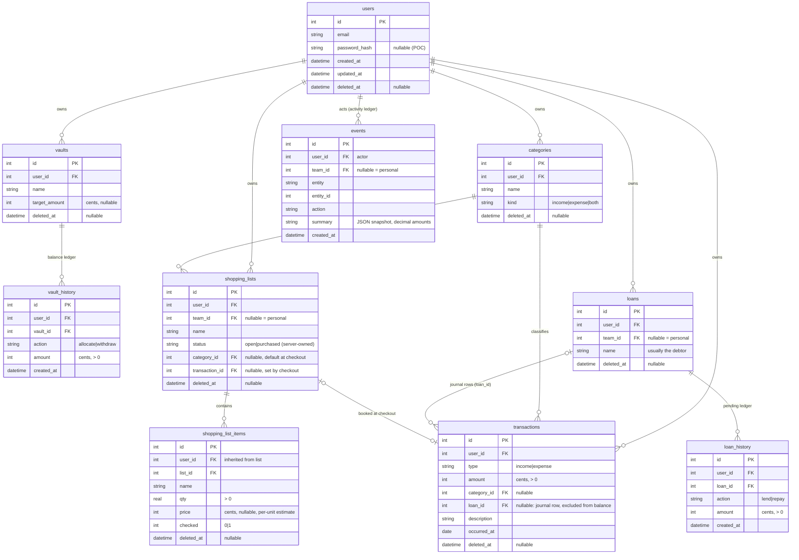
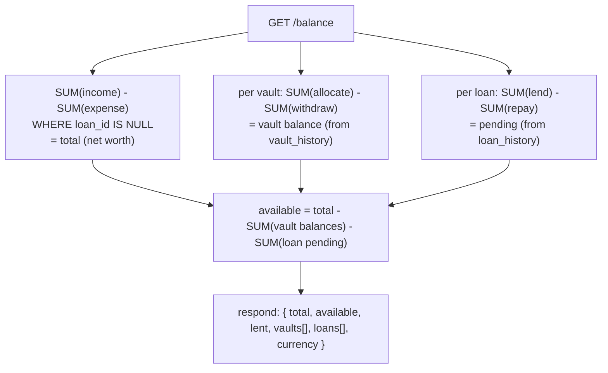
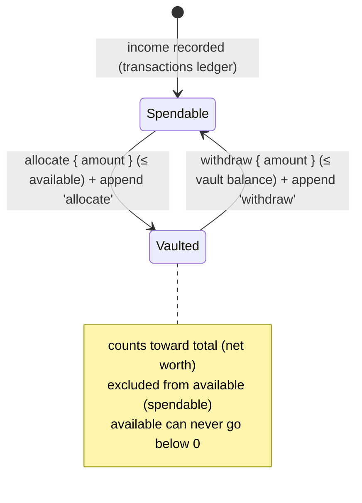
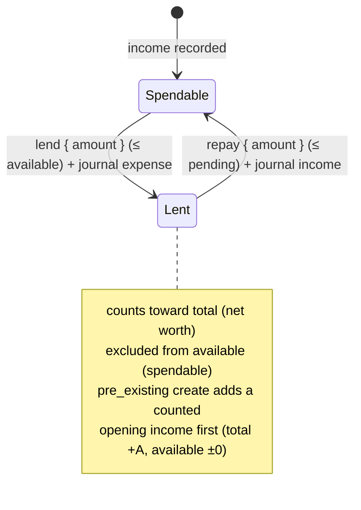
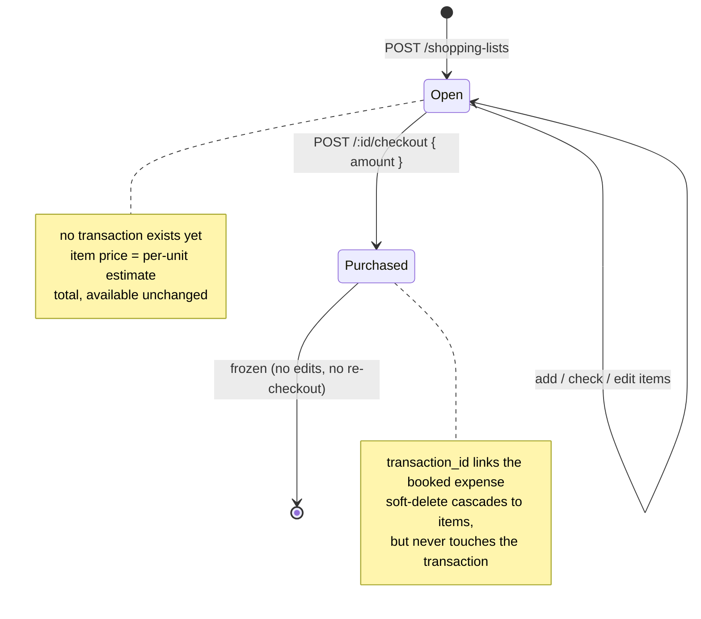
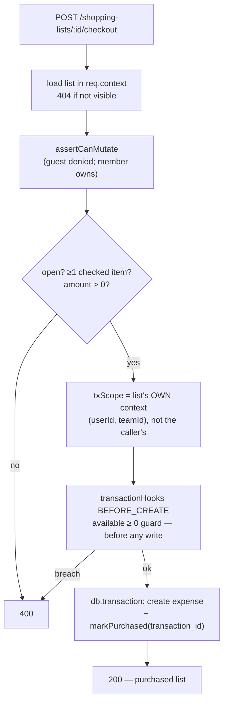
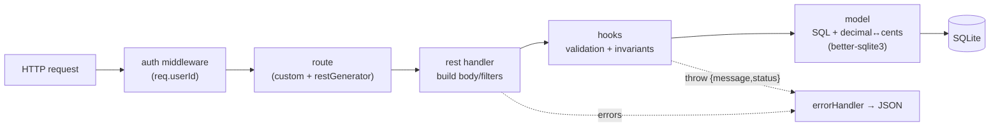

# ARCHITECTURE — `balance`

Agent- and human-readable map of the system: data model, balance logic, request flow, and where everything lives. Pair with `PRD.md` (requirements) and `CLAUDE.md` (commands/conventions).

## Data model (ER diagram)



**Notes**
- All amounts are integer **cents**. API converts to/from decimals at the boundary.
- All tables soft-delete via nullable `deleted_at` (`NULL` = active). Every read filters `deleted_at IS NULL`.
- `transactions` is a **pure ledger** — no vault reference. `vault_history` is the **append-only source of truth** for vault balances (`balance = Σallocate − Σwithdraw`). See ADR-004.
- `loans` mirrors the vault model: no money columns; `loan_history` is the append-only source of truth (`pending = Σlend − Σrepay`, `amount = Σlend`). Lend/repay also book **journal transactions** (`loan_id` set) — display-only, excluded from balance math, read-only via `/transactions`. See ADR-010.
- `shopping_list_items` is keyed by `list_id`, **not** user/team-scoped: a shared list must show every member's items. Access is authorized by resolving the parent list in `req.context`. See ADR-008.
- `events` is a second **append-only ledger** (like `vault_history`): immutable, no soft delete, written from after-hooks/controllers only. Its `summary` amounts are **decimals** (display snapshots), the one deliberate exception to cents-in-DB. See ADR-009.

## Balance calculation flow



Allocate / withdraw move an **amount** between spendable and a vault (independent of any transaction):



## Loans: lent money (ADR-010)

A loan is a receivable — the vault pattern pointed outward. Lend/repay move an **amount** between
spendable and the loan's pending, and each movement also books a **journal transaction**
(`loan_id` set, excluded from balance math, read-only) so `/transactions` tells the whole story:



A loan deletes only at `pending = 0`; journal rows survive deletion (frozen history, like
checkout transactions). Multi-write flows (create-with-amount, pre_existing opening, lend, repay)
each commit in one `db.transaction` with their event.

## Shopping list checkout (ADR-008)

A list is a plan, not money: it touches no balance figure until checkout, which books **one**
expense for the whole list and freezes the list as history.



Checkout is the only writer of `status`/`transaction_id`, and it reuses the transactions
`BEFORE_CREATE` hook rather than reimplementing the `available ≥ 0` guard:



## Request lifecycle (entity pattern)

Each entity is generated, not hand-written per layer. A `Router` mounts any custom
routes first, then `restGenerator` adds the standard CRUD handlers. Handlers fire
lifecycle **hooks** (validation + invariants) around the **model**, which owns the SQL
and the decimal↔cents conversion (via `modelGenerator`).



Generated CRUD lives in `src/utils/`: `modelGenerator` (findAll/findById/create/update/softDelete,
money conversion, user-scope + `deleted_at IS NULL`) and `restGenerator` (GET `/`, GET `/:id`,
POST `/`, PUT `/:id`, DELETE `/:id`). Hook constants: `BEFORE_CREATE`, `CREATE`, `BEFORE_UPDATE`,
`UPDATE`, `LIST_ALL`, `GET_ONE`, `BEFORE_DESTROY`, `DESTROY`.

### RBAC (team context) — ADR-005

`resolveContext` resolves the caller's `team_members.role` (`owner | member | guest`) onto
`req.context = { userId, teamId, role }` (personal context → `role: null`). Two gates, centralized in
`src/lib/access.js` and called from the `restGenerator` write handlers (create/update/destroy) and the
custom vault write routes (allocate/withdraw):

- **Gate 1 (capability):** `guest` is read-only; owner/member/personal may write.
- **Gate 2 (ownership):** for edit/delete/allocate/withdraw, a `member` may act only on rows they
  created; `owner` bypasses; personal is already `user_id = self`-scoped (no-op).

Reads (GET) are open to all roles. Team management (rename/delete/add/remove/change-role) is
owner-only **by role** (not `teams.user_id`), so multiple owners work. `team_members.role` now
includes `guest`. Ownership for team writes is decided in the handler layer (`access.js`).

**Global admin (ADR-006).** `users.role` (`user|admin`) is a platform-level role carried in the JWT
and surfaced as `req.isAdmin` / `req.context.isAdmin` by `auth.js`. An admin **overrides** team RBAC,
membership, and ownership: `access.js` gates and the teams `requireRole` short-circuit; `resolveContext`
grants any team and enables an admin-only `?user_id=` selector; `modelGenerator` gives admins god-mode
single-row access by id and cross-user/team list scoping. Integrity invariants stay enforced for admins.

## Directory map

```
balance/
├── src/
│   ├── config/
│   │   ├── env.js          # load/validate .env.<NODE_ENV>; export config
│   │   └── db.js           # better-sqlite3 connection (path from config)
│   ├── db/
│   │   ├── schema.sql      # full DDL: tables, indexes, constraints
│   │   ├── migrate.js      # apply schema.sql
│   │   └── seed.js         # seed user_id=1 + default categories
│   ├── constants/
│   │   └── hooks.js        # lifecycle hook type constants
│   ├── middleware/
│   │   ├── auth.js         # POC: inject req.userId = 1 (swap for real auth)
│   │   └── errorHandler.js # central error → JSON + status
│   ├── lib/
│   │   ├── money.js        # decimal ↔ cents
│   │   └── pagination.js   # limit/positive-int parsing + keyset cursor codec
│   ├── utils/
│   │   ├── modelGenerator/ # generic CRUD model (SQL + money conversion)
│   │   └── restGenerator/  # generic CRUD routes + handlers/ (fire hooks)
│   ├── entities/
│   │   ├── transactions/   # constants, db/{fields,model}, http/{hooks,routes}
│   │   ├── vaults/         # + http/controller (allocate/withdraw/history), db/history
│   │   ├── loans/          # + http/controller (create semantics/lend/repay/history), db/history
│   │   ├── categories/     # constants, db/{fields,model}, http/{hooks,routes}
│   │   ├── balance/        # db/queries (aggregate), http/routes
│   │   ├── shopping-lists/ # + http/controller (checkout → books one expense)
│   │   ├── shopping-list-items/  # hand-written model: list-keyed, not user-scoped
│   │   ├── events/         # append-only activity ledger; hand-written model + read-only /events feed
│   │   └── index.js        # collects all entities
│   ├── app.js              # express wiring (mounts entity routes + middleware)
│   └── server.js           # boot: config → migrate → seed → listen
├── test/
│   ├── testSetup.js        # Jest global setup: fresh test DB per run
│   ├── helpers/            # db (schema+wipe+seed), api (supertest+login)
│   ├── unit-testing/       # pure-function specs (money, normalizeColor)
│   └── integration-test/   # HTTP specs per entity (auth, teams, balance)
├── jest.config.js          # serial suites over a shared SQLite test DB
├── .env.example            # committed template
├── .env.test               # committed (no secrets; throwaway DB)
├── .env.stage              # gitignored
├── .env.prod               # gitignored
├── data/                   # gitignored: balance.{stage,prod,test}.db
├── .claude/agents/plans/   # feature plans (/plan-feature output)
├── PRD.md
├── CLAUDE.md
├── ARCHITECTURE.md
└── README.md
```

## Conventions recap

- **Entity pattern:** each resource is a generated model + routes under `src/entities/<name>/`. Custom routes register **before** `restGenerator` so they aren't shadowed by `/:id`.
- **Validation & invariants** live in `http/hooks.js` (throw `{ message, status }` to short-circuit) — not in routes or handlers. No SQL outside `db/model.js` (or `db/queries.js` for balance).
- **Cross-entity access:** import the model file directly (e.g. `../../transactions/db/model`), never via the entity `index.js`, to avoid circular deps.
- **Money:** stored as integer cents; the model layer (`modelGenerator` `moneyFields`) converts decimal↔cents at the read/write boundary.
- **Auth-ready:** all tables carry `user_id`; only the auth middleware changes in Phase 2.
- **Balances are derived** from the ledgers (`transactions` where `loan_id IS NULL`, `vault_history`, `loan_history`) — never stored. Cent-level helpers live in `balance/db/queries.js` and are reused by transaction hooks (the `available ≥ 0` guard) and the vaults/loans controllers.
- **Invariants:** positive amounts; `available ≥ 0` on every spendable-affecting write; withdraw ≤ vault balance; lend ≤ available; repay ≤ pending; a vault deletes only at balance 0, a loan only at pending 0. Loan journal rows are read-only via `/transactions`. See ADR-004/ADR-010.
- **RBAC:** team roles `owner|member|guest` resolved onto `req.context.role` by `resolveContext`; two gates (capability + ownership) in `src/lib/access.js`; team management is owner-only by role; a team deletes only when empty (no active transactions/vaults). See ADR-005.
- **Child collections scope by parent:** `shopping_list_items` is keyed by `list_id` (not user/team) and authorized by resolving the parent list in `req.context` — so it bypasses `modelGenerator` for a hand-written model. Shopping lists stay out of the ledger until checkout books one expense, reusing the transactions `BEFORE_CREATE` hook for the `available ≥ 0` guard. See ADR-008.
- **Transactions list:** `GET /transactions` is a custom search route (not the generic list): filters (`q`, `from`/`to`, `type`, `category_id`, `loans`, `sort`) + keyset paging on `(occurred_at, id)` return `{ items, next_cursor, totals }`; totals span the whole filtered set and skip journal rows. Index `idx_transactions_occurred(team_id, occurred_at, id)`. See ADR-011.
- **Activity events:** every successful mutation appends to the `events` ledger — from the after-hooks (`CREATE`/`UPDATE`/`DESTROY`) for generated CRUD, from the owning controller for custom flows (allocate/withdraw, checkout inside its atomic commit, team management). Actor = `req.userId`; context = the **affected record's** `team_id`. `GET /events` is the read-only, context-scoped, newest-first feed. Remote push (Expo) is the recorded delivery north star. See ADR-009.
